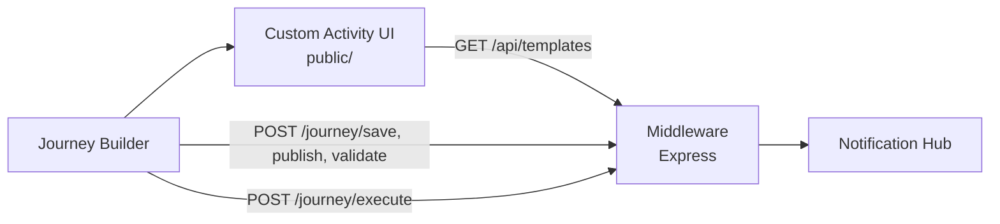

# Salesforce Custom Activity - Notification Hub

A Salesforce Marketing Cloud **Journey Builder Custom Activity** that lets journey designers pick a Notification Hub template, map Data Extension fields to its parameters, and send the notification through a middleware.

> Status: **MVP with Postmonger save/load**. The Custom Activity UI connects to Journey Builder through Postmonger: it loads new or existing activity configurations, saves the selected template and field mappings into the activity definition, and generates runtime `inArguments` with Salesforce bindings. Notification Hub integration, JWT validation and the real `/journey/execute` business logic are still out of scope.

---

## 1. Overview

```text
Journey Builder  -->  Custom Activity (UI)  -->  Middleware  -->  Notification Hub
```

Goals of the activity:

1. Select a Notification Hub template.
2. Map Data Extension fields to template parameters.
3. Send the notification via the middleware.
4. Support SMS, ZNS, Email and Push later without changing UI code.

Notification Hub has no public template API yet, so templates will come from a fake API inside the middleware. Replacing that source later must not require changes to the UI, mapping screen, save logic or execute logic.

---

## 2. Architecture

### 2.1 Runtime flow



### 2.2 Layered structure (Clean Architecture)

```text
HTTP (routes)  ->  Controllers  ->  Services (domain/application)  ->  Clients / Repositories (infrastructure)
```

| Layer | Location | Responsibility |
|---|---|---|
| Routes | `server/routes/` | Map HTTP paths to controller handlers |
| Controllers | `server/controllers/` | Translate HTTP requests and responses |
| Services | `server/services/` | Business rules and orchestration (no HTTP types) |
| Clients | `server/services/notification-hub.client.js` | Only place that talks to Notification Hub |
| Repositories | `server/repositories/` | Data access (template source, later swapped for Notification Hub) |
| Middleware | `server/middleware/` | Cross-cutting HTTP concerns (errors, 404) |
| Composition root | `server/container.js` | Wires concrete implementations together |

Dependencies point inward: controllers receive services through their constructors, and services receive clients/repositories the same way. Swapping the template source only touches the container and the client/repository implementation.

### 2.3 Planned payload flow

```text
Journey Builder resolves values
   -> POST /journey/execute
   -> ValidatorService / MappingService
   -> PayloadBuilder
   -> NotificationHubClient.send()
```

---

## 3. Project Structure

```text
salesforce-custom-activity/
├── public/                     # Custom Activity frontend (static, vanilla JS, no framework)
│   ├── index.html
│   ├── css/
│   │   └── main.css
│   ├── js/
│   │   ├── app.js                    # Entry point: Postmonger lifecycle, save gate, rendering
│   │   ├── postmonger-client.js      # The ONLY module that talks to the Postmonger SDK
│   │   ├── activity-loader.js        # initActivity -> ActivityState hydration (new/restored/missing)
│   │   ├── activity-saver.js         # Builds the updated activity definition (merge, no mutation)
│   │   ├── binding-builder.js        # Field mappings -> {{Event.KEY.Field}} bindings + inArguments
│   │   ├── standalone-adapter.js     # Local dev mode: same interface as PostmongerClient
│   │   ├── schema/
│   │   │   ├── entry-schema-provider.js   # Postmonger discovery orchestration
│   │   │   ├── entry-schema-normalizer.js # Raw Journey Builder metadata -> field model
│   │   │   ├── field-catalog-model.js     # Normalized field catalog model
│   │   │   └── field-type-normalizer.js   # Source data types -> internal type system
│   │   ├── vendor/
│   │   │   ├── postmonger.js         # Official Postmonger SDK (v0.0.14, classic script)
│   │   │   └── POSTMONGER-LICENSE.txt
│   │   ├── domain/
│   │   │   ├── mappingTargets.js     # Target keys derived from template groups
│   │   │   ├── mappingValidator.js   # Pure validation rules -> { valid, errors, warnings }
│   │   │   └── typeCompatibility.js  # Source-to-target type compatibility rules
│   │   ├── services/
│   │   │   └── templateApi.js        # GET /api/templates client
│   │   ├── state/
│   │   │   └── activityState.js      # templates, selection, mappings, activity, schema
│   │   └── ui/
│   │       ├── channelSelector.js    # Channel dropdown (SMS, ChatApp, Zalo, BRC Zalo)
│   │       ├── templateDropdown.js   # Template select, filtered by channel
│   │       ├── templateDetails.js    # Display name, key, channel, version
│   │       ├── templateChangeDialog.js # Confirm before clearing mappings
│   │       ├── mappingSection.js     # Groups: Addresses, Recipient Fields, Parameters
│   │       ├── mappingRow.js         # One target: source, search, stale notice, status
│   │       ├── mappingSummary.js     # Current Mapping (debug / pre-save)
│   │       ├── schemaStatusPanel.js  # Journey Entry Schema card (loading / ready / unavailable / error / Retry)
│   │       └── validationPanel.js    # Validation Status (green / red / amber)
│   └── fixtures/
│       └── entry-schema.fixture.json # Standalone entry-schema fixture (never loaded in real mode)
│   └── assets/
├── server/
│   ├── app.js                  # Express app factory
│   ├── config.js               # Environment configuration
│   ├── container.js            # Composition root (async; loads template catalog)
│   ├── logger.js               # Lightweight logger
│   ├── routes/
│   │   ├── health.routes.js
│   │   ├── templateRoutes.js
│   │   └── journey.routes.js
│   ├── controllers/
│   │   ├── not-implemented.js
│   │   ├── templateController.js
│   │   └── journey.controller.js
│   ├── services/
│   │   ├── templateService.js
│   │   ├── mapping.service.js
│   │   ├── notification-hub.client.js
│   │   ├── journey.service.js
│   │   ├── payload.builder.js
│   │   └── validator.service.js
│   ├── repositories/
│   │   └── templateRepository.js   # Reads and validates templates.json
│   ├── models/
│   │   └── templateModel.js        # Template model + validation rules
│   ├── middleware/
│   │   ├── error-handler.middleware.js
│   │   └── not-found.middleware.js
│   ├── validators/             # Request schema validators (planned)
│   └── data/
│       └── templates.json      # Fake template catalog for MVP
├── tests/
│   ├── health.test.js
│   ├── routes.placeholder.test.js
│   ├── templateRepository.test.js
│   ├── templateService.test.js
│   ├── templateController.test.js
│   ├── templateModel.test.js
│   ├── schema/
│   │   ├── field-type-normalizer.test.js
│   │   ├── entry-schema-normalizer.test.js
│   │   ├── entry-schema-provider.test.js
│   │   ├── standalone-adapter.test.js
│   │   └── discovery-integration.test.js   # Scenarios 1-6 (mocked bridge)
│   └── ui/
│       ├── activityState.test.js
│       ├── activity-state-schema.test.js
│       ├── mappingState.test.js
│       ├── mappingValidator.test.js
│       ├── mapping-validator-schema.test.js
│       ├── templateApi.test.js
│       ├── binding-builder.test.js
│       ├── binding-builder-schema.test.js
│       ├── activity-loader.test.js
│       ├── activity-saver.test.js
│       ├── postmonger-interaction.test.js
│       ├── field-matching.test.js
│       ├── activity-config-key.test.js
│       ├── postmonger-client.test.js
├── docs/
├── package.json
├── .gitignore
├── server.js                   # Process bootstrap (listen, signals)
└── README.md
```

---

## 4. Endpoints

| Method | Path | Status | Purpose |
|---|---|---|---|
| GET | `/health` | 200 | Liveness: `{ "status": "ok", "service": "salesforce-custom-activity" }` |
| GET | `/api/templates` | 200 | Template catalog (`{ "items": [...] }`) from the data file. Optional `?channel=Zalo` (or `ZALO`) returns only that channel; an unsupported channel returns 400 |
| POST | `/journey/save` | 200 / 400 | Validates and acknowledges the activity configuration (JWT when enabled) |
| POST | `/journey/validate` | 200 / 400 | Validates the configuration with structured errors |
| POST | `/journey/publish` | 200 / 400 | Publish-time validation; requires `metaData.isConfigured` |
| POST | `/journey/stop` | 200 | Idempotent stop notification |
| POST | `/journey/execute` | 200 / 400 / 502 | Builds the Notification Hub payload and sends it (JWT when enabled) |
| GET | `/config.json` | 200 | Activity definition, every URL built from `PUBLIC_BASE_URL` |
| GET | `/ready` | 200 / 503 | Configuration readiness, no secret values |

Placeholder responses:

```json
{ "message": "Not implemented" }
```

> Note: for this MVP the Custom Activity UI does **not** call any backend save endpoint. The editor configuration is persisted inside the Journey Builder activity definition via Postmonger `updateActivity` (see section 9). The `/journey/*` routes remain placeholders for the later execute phase.

---

## 5. Template Catalog API

Returns every Notification Hub template available to the Custom Activity. For MVP the data comes from `server/data/templates.json`; later the repository is swapped for `NotificationHubClient` and the response shape stays the same.

**Endpoint:** `GET /api/templates`

**Example request:**

```bash
curl http://localhost:3000/api/templates
```

**Example response (200 OK, truncated):**

```json
{
  "items": [
    {
      "templateKey": "vac.service-change-notice.sms.988dfeff",
      "displayName": "Vaccine Service Change SMS",
      "channel": "sms",
      "version": 1,
      "addresses": [{ "name": "phone", "required": true, "type": "phone" }],
      "recipientFields": [{ "name": "customerId", "required": true, "type": "string" }],
      "params": [
        { "name": "vaccinator", "required": true, "type": "string" },
        { "name": "diseaseName", "required": true, "type": "string" }
      ]
    }
  ]
}
```

**Error response (500):**

```json
{ "message": "Unable to load templates" }
```

**Template fields:** `templateKey`, `displayName`, `channel` (`SMS` | `CHATAPP` | `ZALO` | `BRC_ZALO`; the data file may use the display names "SMS", "ChatApp", "Zalo", "BRC Zalo"), `version` (defaults to 1), `addresses[]`, `recipientFields[]`, `params[]`. Each entry in `addresses`, `recipientFields` and `params` has `name`, `required` and `type`.

**Startup validation:** the catalog is loaded when the server starts. The server refuses to start (exit code 1) if `templates.json` is missing, empty, not valid JSON, has no `items` array, has an entry missing `templateKey`, `displayName`, `channel`, `addresses` or `params`, uses an unsupported channel, or repeats a `templateKey`. An empty `items` array is valid and returns `{ "items": [] }`.

**Layers:** `templateRoutes.js` -> `templateController.js` -> `templateService.js` -> `templateRepository.js` -> `data/templates.json`.

**Out of scope for now:** `GET /template/{id}`, `GET /channels`, `GET /versions`.

## 6. Development Setup

### Prerequisites

- **Node.js 22 or newer** (enforced via `engines` in `package.json`)
- npm (ships with Node)

### Steps

```bash
# 1. Install dependencies
npm install

# 2. Start the server (default port 3000, override with PORT)
npm start

# 3. Verify
curl http://localhost:3000/health
```

Optional environment variable:

| Name | Default | Description |
|---|---|---|
| `PORT` | `3000` | HTTP port the Express server listens on |

Do not commit `.env` files or secrets. `.gitignore` already excludes them.

---

## 7. Commands

| Command | Description |
|---|---|
| `npm install` | Install dependencies |
| `npm start` | Start the server (`node server.js`) |
| `npm run dev` | Start with file watching (`node --watch server.js`) |
| `npm test` | Run the Jest test suite (ES modules, native VM modules) |
| `npm run test:watch` | Run Jest in watch mode |

---

## 8. Coding Conventions

- ES Modules only (`"type": "module"`). No CommonJS (`require`, `module.exports`).
- Async/await for all asynchronous code.
- Controllers stay thin; business logic goes into services.
- Services receive their dependencies via constructors.
- Frontend uses vanilla JavaScript, HTML and CSS. Postmonger is the only vendored library, wrapped by `postmonger-client.js`.

---

## 9. Postmonger Integration

The Custom Activity communicates with Journey Builder through **Postmonger**. The official SDK is vendored at `public/js/vendor/postmonger.js` (loaded as a classic script) and is wrapped by exactly one module, `public/js/postmonger-client.js`. No other UI module calls Postmonger directly.

### 9.1 PostmongerClient

`PostmongerClient` hides the raw Postmonger session:

| Method | Purpose |
|---|---|
| `initialize()` | Creates the session, registers all SDK listeners **once**, triggers `ready` |
| `onInitActivity(cb)` | Activity definition delivered by Journey Builder |
| `onClickedNext(cb)` | User clicked Next / Done |
| `onClickedBack(cb)` | User clicked Back |
| `onGotoStep(cb)` | Step navigation `(step, nextStep)` |
| `onRequestedTriggerEventDefinition(cb)` | Response to the event-definition request |
| `onRequestedInteraction(cb)` | Response to the interaction request (journey triggers and entry metadata) |
| `updateActivity(activity)` | Sends the updated activity definition back |
| `updateButton(config)` | Enables/disables/labels the Next button |
| `nextStep()` / `previousStep()` | Step navigation |
| `requestTriggerEventDefinition()` | Requests the journey entry event definition |
| `requestInteraction()` | Requests the current interaction (journey) including its triggers |
| `destroy()` | Ends the session and drops all handlers |

Handlers are stored in `Set`s, so re-registering the same callback never creates duplicate listeners. The wrapper throws if the SDK is missing. An embedded page reports that as a connection and schema error; it never falls back to the standalone fixture.

### 9.2 Activity initialization lifecycle

```
page load
  -> create bridge (PostmongerClient | StandaloneAdapter)
  -> create EntrySchemaProvider (registers its response listeners)
  -> register ALL remaining listeners (initActivity, clickedNext, clickedBack,
     clickedGotoStep)
  -> bridge.initialize()                 // triggers Postmonger 'ready'
  -> await Promise.all([loadTemplates(), initActivity])
  -> loadActivityIntoState()             // hydrate ActivityState
  -> render UI, configure buttons
  -> schemaProvider.discover()           // event definition + entry schema
  -> state.setEntrySchemaResult(result)  // normalized field catalog
```

Both prerequisites — the template catalog (`GET /api/templates`) and the activity definition (`initActivity`) — must arrive before the UI settles. Coordination is promise-based; there are **no arbitrary init timeouts**.

### 9.3 Entry schema discovery

`EntrySchemaProvider` (`public/js/schema/`) discovers the Journey entry schema through Postmonger:

1. `requestInteraction` → `requestedInteraction`: the interaction's `triggers[0].metaData` supplies the `eventDefinitionKey` and, when present, the Data Extension field list. Nothing outside `triggers[0].metaData` is read. See section 9.20.

Raw payloads are normalized by `entry-schema-normalizer.js` into the field catalog model (`field-catalog-model.js`): `id`, `name`, `label`, `dataType`, `bindingPath` plus optional metadata. Field types are mapped by `field-type-normalizer.js`, and source-to-target type compatibility is checked by `domain/typeCompatibility.js` (warnings never block save; incompatible types do).

Each request waits at most 8 seconds for Journey Builder to answer. A timed-out request yields `SCHEMA_NOT_AVAILABLE` and is recoverable through Retry; late responses are ignored. This is a failure detector for an unanswered request, not an initialization timeout.

When the schema is unavailable the UI stays usable: field mappings are blocked from saving, static mappings remain editable, and stale saved fields (absent from a READY catalog) are flagged for replacement.

### 9.3 Saved configuration model

Editor configuration is stored **inside the Journey Builder activity definition**, separate from resolved runtime values:

```json
{
  "metaData": { "isConfigured": true },
  "arguments": {
    "execute": {
      "inArguments": [ { "...": "runtime values with bindings" } ],
      "configurationArguments": {
        "templateKey": "fptlc.order-confirm.zns.6a12eabf",
        "templateVersion": 1,
        "channel": "zns",
        "eventDefinitionKey": "ORDER_ENTRY_EVENT",
        "mappings": {
          "addresses.phone": { "mode": "field", "value": "MobilePhone" },
          "customerId": { "mode": "field", "value": "CustomerId" },
          "params.customerName": { "mode": "field", "value": "CustomerName" },
          "params.token": { "mode": "static", "value": "controlled-static-value" }
        }
      }
    }
  }
}
```

- The chosen property is **`arguments.execute.configurationArguments`**.
- Only `inArguments`, `configurationArguments` and `metaData.isConfigured` are merged into a **clone** of the original activity. Properties such as `url`, `timeout`, `retryCount`, `retryDelay`, `concurrentRequests` and `useJwt` are preserved untouched.
- The original activity object is never mutated.
- Configuration-only information is never placed inside the Notification Hub request payload.

### 9.4 Runtime inArguments model

Runtime input is a flat list: one object per argument, one key per object, string values. Nested objects are no longer produced (section 9.23 explains why).

```json
[
  { "source": "sf-marketing-cloud" },
  { "channel": "ZALO" },
  { "templateKey": "fptlc.order-confirm.zns.6a12eabf" },
  { "templateVersion": "1" },
  { "eventDefinitionKey": "ORDER_ENTRY_EVENT" },
  { "address__phone": "{{Event.ORDER_ENTRY_EVENT.\"MobilePhone\"}}" },
  { "recipient__customerId": "{{Event.ORDER_ENTRY_EVENT.\"CustomerId\"}}" },
  { "param__customerName": "{{Event.ORDER_ENTRY_EVENT.\"CustomerName\"}}" },
  { "param__shopName": "Long Chau Pharmacy" }
]
```

- Keys are generated deterministically from target names by `public/js/shared/runtime-key-builder.js`: `address__<name>`, `recipient__<name>`, `param__<name>`. Target names containing `__` or ending with `_` are rejected.
- Unmapped optional targets are omitted.
- Field mode produces a quoted binding; static mode preserves the literal value.
- The server validates the same keys and bindings in `server/services/lifecycle-service.js`.


### 9.5 New versus existing activity behavior

**New activity** (no `configurationArguments`):

1. Original activity definition preserved.
2. Configuration marked as new; `metaData.isConfigured` stays false.
3. First template preselected after templates load.
4. Mappings start empty; validation shows the unmapped required targets.
5. `inArguments` are only generated when the user saves.

**Existing activity** (reopened):

1. `configurationArguments` read from the activity definition.
2. Matching template found in the catalog and restored.
3. All mapping modes and values restored (field and static).
4. `isConfigured` restored from `metaData`.
5. Live validation runs immediately.
6. If the saved template no longer exists: a warning shows the saved key, **no automatic replacement** happens, and the user must pick a replacement. Mappings for the missing template are not applied.
7. Malformed saved configurations produce a recoverable error; the activity is treated as new.

### 9.6 Event definition key and schema

After initialization the UI discovers the journey entry event definition and schema and stores the normalized field catalog in state. If discovery fails:

- The UI stays usable and shows a clear warning in the Journey Entry Schema card.
- Field-based mappings are blocked from saving.
- Static mappings remain editable.

The fake event key and field list are used **only** in standalone mode (from `public/fixtures/entry-schema.fixture.json`), never inside a real Journey Builder session.

### 9.7 Standalone development mode

The UI runs outside Journey Builder for local development. It activates when:

- the URL contains `?standalone=true`, or
- the page is **not embedded in an iframe** (a top-level page can never be a Journey Builder session).

An embedded page whose Postmonger SDK is missing never falls back to standalone mode. It shows an error in the Journey Entry Schema card instead.

`standalone-adapter.js` implements the same interface as `PostmongerClient` and:

- supplies a sample activity definition (or the last saved fixture from `localStorage`),
- answers schema discovery from `public/fixtures/entry-schema.fixture.json` through the **same** code path as production (event definition + data sources), so the normalizer runs on realistic input,
- logs every `updateActivity` payload to the console and shows it on screen,
- persists the payload to `localStorage` so save → reload → restore can be tested,
- visibly identifies itself with a "Standalone Development Mode" banner and Simulate Next / Back / Reset Fixture buttons.

### 9.8 Manual test checklist

**Scenario 1: New activity**

1. Add the activity to a Journey.
2. Open configuration.
3. Select the ZNS template.
4. Map all required targets.
5. Click Done.
6. Reopen the activity.
7. Confirm the template and mappings are restored.

**Scenario 2: Static mapping**

1. Set one optional parameter to Static Value.
2. Save the activity.
3. Reopen it.
4. Confirm mode and value are restored.

**Scenario 3: Invalid mapping**

1. Leave `addresses.phone` unmapped.
2. Click Done.
3. Confirm save is blocked.
4. Confirm a validation message appears and the first invalid row is focused.

**Scenario 4: Template removed**

1. Save an activity with one template.
2. Remove that template from `templates.json`.
3. Reopen the activity.
4. Confirm the missing-template warning appears.
5. Confirm no automatic replacement occurs.

**Scenario 5: Standalone mode**

1. Open the UI with `?standalone=true`.
2. Configure mappings.
3. Click Simulate Next.
4. Copy the logged activity definition.
5. Reload the page; confirm the configuration is restored from the fixture.

### 9.9 Known MVP limitations

- **Mapping definitions are saved in the activity definition** (`arguments.execute.configurationArguments`); there is no separate save API.
- **Field values are resolved by Journey Builder at execution time** through quoted `{{Event.<key>."<Field>"}}` bindings (live gate B in section 9.23).
- **The browser does not store resolved customer data** — only mapping definitions and literals configured by the designer.
- **Entry-schema discovery is implemented** through Postmonger (`requestInteraction` → `requestedInteraction`), reading only `triggers[0].metaData`, normalized into the internal field catalog. The standalone fixture (`public/fixtures/entry-schema.fixture.json`) substitutes for a live journey during local development.
- The official sample confirms the `triggers[0].metaData.eventDefinitionKey` location, but it contains no Data Extension field list. A live capture is required before real field discovery can be considered verified.
- `POST /journey/execute` business logic, Notification Hub integration and JWT verification are not implemented.
- If a live journey shows a different key or field location, change `normalizeInteraction()` in `schema/entry-schema-normalizer.js` and add a fixture test for the captured shape.
- Live Journey Builder verification of `requestInteraction` / `requestedInteraction` is still pending. See section 9.20.

### 9.10 Postmonger events used (confirmed versus unverified)

Confirmation sources: the vendored SDK (`public/js/vendor/postmonger.js`, v0.0.14) is a generic event bus; it defines no event names. Event names therefore come from Journey Builder. The official Postmonger reference (developer.salesforce.com) could not be fetched during development (HTTP 403), so the status below is based on the repository's existing integration, a Stack Overflow answer, and a community repository. **Re-verify every row against the official reference or a captured live payload before release.**

| Direction | Event | Payload used | Status |
|---|---|---|---|
| UI -> JB | `ready` | none | in use (existing integration) |
| JB -> UI | `initActivity` | activity definition | in use (existing integration) |
| UI -> JB | `requestTriggerEventDefinition` | none | wrapper kept for compatibility; discovery no longer uses it |
| JB -> UI | `requestedTriggerEventDefinition` | `{ eventDefinitionKey, ... }` | wrapper kept for compatibility; discovery no longer uses it |
| UI -> JB | `requestInteraction` | none | in use. Event name from the project specification; payload shape from the official sample (see 9.20). Not found in the official reference during development (HTTP 403) |
| JB -> UI | `requestedInteraction` | interaction object; `triggers[0].metaData.eventDefinitionKey` confirmed by the official sample | in use |
| UI -> JB | `updateActivity`, `updateButton`, `nextStep`, `previousStep` | activity / button config | in use (existing integration) |
| JB -> UI | `clickedNext`, `clickedBack`, `gotoStep` | step data | in use (existing integration) |

Events that were **not** used because no source confirmed them: `requestSchema` / `requestedSchema` (mentioned only as undocumented in a Stack Overflow answer) and `requestEntryEventDefinitionKey`. No fictional events were added.

If a live journey never answers `requestInteraction`, discovery ends in `SCHEMA_NOT_AVAILABLE` after the response deadline. The UI stays usable with static values only.

### 9.11 Confirmed response structures

Structures below are the only shapes the normalizer reads. Anything else is ignored or reported.

**Trigger event definition (`requestedTriggerEventDefinition`)**

```json
{ "eventDefinitionKey": "ORDER_ENTRY_EVENT" }
```

Optional embedded field list, accepted when present (not confirmed in a live payload):

- `schema`: `[{ "key": "Event.<key>.<Field>", "type": "Text", ... }]`
- `deSchema.fields`: `[{ "name": "MobilePhone", "type": "Phone", ... }]`

**Superseded (community-documented, not used by the current flow): data sources (`requestedDataSources`)**

```json
[
  {
    "id": "Event",
    "eventDefinitionKey": "DEAudience-eabac269-8abc-2a8b-aebb-56d0728fdfb3",
    "keyPrefix": "Event.DEAudience-eabac269-8abc-2a8b-aebb-56d0728fdfb3.",
    "deSchema": {
      "fieldCount": 3,
      "fields": [
        { "name": "ContactKey", "type": "Text", "ordinal": 0, "length": 50, "isNullable": false, "isPrimaryKey": true },
        { "name": "Email", "type": "EmailAddress", "ordinal": 1, "length": 254, "isNullable": true, "isPrimaryKey": false }
      ]
    }
  }
]
```

The entry source is the item whose `eventDefinitionKey` equals the key from the trigger response. Other items are ignored.

### 9.12 Normalized field model

Each field produced by `entry-schema-normalizer.js` (via `field-catalog-model.js`):

```json
{
  "id": "MobilePhone",
  "name": "MobilePhone",
  "label": "Mobile Phone",
  "dataType": "Phone",
  "source": "entryEvent",
  "bindingPath": "MobilePhone",
  "nullable": true,
  "length": 20,
  "ordinal": 2,
  "isPrimaryKey": false
}
```

Required: `id`, `name`, `label`, `dataType`, `source`, `bindingPath`. Optional metadata is included only when the source supplied a valid value. The catalog is frozen; UI components receive copies, never raw Journey Builder objects.

**Normalization rules**

- Name: `name`, else the last segment of `key` (`Event.<key>.<Field>` gives `<Field>`). Names must match `^[A-Za-z_][A-Za-z0-9_]*$`; others are skipped with a `FIELD_SKIPPED` warning.
- Label: the supplied `label` when present, otherwise a humanized name (`CustomerId` gives `Customer Id`).
- `id` and `bindingPath` equal the name for entry-event fields.
- Duplicates: the first occurrence wins; later ones produce `DUPLICATE_FIELD`.
- Order: source order is kept. Fields are sorted by `ordinal` only when every field has one.
- Unknown types: `dataType` becomes `Unknown` and the field produces `UNKNOWN_FIELD_TYPE`. The schema is not rejected.
- Input is never mutated. Raw objects are read, never written.
- At most 500 fields are processed.

**Type aliases** (`field-type-normalizer.js`, case-insensitive)

| Source type | Normalized |
|---|---|
| `Text`, `text`, `string` | Text |
| `Phone`, `phone` | Phone |
| `EmailAddress`, `email` | Email |
| `Number`, `number` | Number |
| `Decimal`, `decimal` | Decimal |
| `Integer`, `integer`, `int` | Integer |
| `Date`, `date` | Date |
| `DateTime`, `datetime` | DateTime |
| `Boolean`, `boolean` | Boolean |
| anything else | Unknown |

`EmailAddress`, `Date`, `DateTime`, `Number`, `Decimal`, `Boolean` and `Text` appear in the community example. `string`, `phone`, `integer`, `datetime` come from the project specification and are not yet verified against a live payload.

### 9.13 Field-type compatibility

Implemented in `domain/typeCompatibility.js`. Target types come from template parameters. The template type `url` is treated as `string`. Any other unknown target type produces a warning.

| Source to target | Result |
|---|---|
| Any known type to `string` | compatible, ok |
| Text to phone, Text to email | compatible, **warning** (validated at runtime) |
| Phone to phone, Email to email | compatible, ok |
| Integer to number or decimal; Number to number or decimal; Decimal to number or decimal | compatible, ok |
| Date to date; DateTime to datetime; Boolean to boolean | compatible, ok |
| DateTime to date | compatible, **warning** |
| Date to number, Boolean to date, Email to decimal, Phone to date | **incompatible, blocks save** |
| Any other pair (for example Text to number) | **incompatible, blocks save** |
| Unknown source type | compatible, **warning**; the field can be selected |

Warnings never block save. Runtime conversion and validation belong to the middleware and are not implemented here.

### 9.14 Stale mappings and schema-unavailable behavior

**Stale mapping:** the saved field is absent from a READY catalog. This happens after a field is renamed or removed in the entry source.

- The saved value is kept and shown in the row ("Previously mapped field: OldPhone"), with the status "Field no longer exists in the Journey entry schema" and a "Choose replacement field" action.
- The row's field selection is reset, so the designer must choose a replacement or clear the mapping.
- The validator reports `SOURCE_FIELD_NOT_FOUND`, which blocks save.
- A schema refresh never clears mappings automatically.

**Schema unavailable** (`unavailable`, `empty` or `error` status):

- Field-mode radio buttons are disabled and a hint explains why.
- Static mappings stay editable and valid.
- Field mappings still in the saved configuration are kept. They produce `SCHEMA_UNAVAILABLE` and block save; nothing is judged stale while the schema is not ready.
- Next/Done stays disabled while discovery is running.

### 9.15 Retry behavior

Retry in the Journey Entry Schema card:

1. sets the schema status to loading,
2. sends the discovery requests again,
3. normalizes the new response and replaces the catalog,
4. revalidates mappings and re-renders the rows, keeping every valid selection.

`EntrySchemaProvider.discover()` shares one in-flight promise across concurrent calls, so repeated clicks never send duplicate requests. Each request waits at most `DISCOVERY_RESPONSE_TIMEOUT_MS` (8 seconds). This deadline detects an unanswered request. It is not an initialization timeout. Late responses are ignored.

### 9.16 Standalone fixture and diagnostics

- **Fixture:** `public/fixtures/entry-schema.fixture.json` (event key `LOCAL_ORDER_ENTRY`, eight example fields). The standalone adapter answers discovery from this fixture through the same provider code path as production. Standalone mode shows a "Standalone Development Mode" badge and binds fields to `LOCAL_ORDER_ENTRY`.
- **Real mode never loads the fixture.** The adapter is constructed only when standalone mode is active. An embedded page with a missing SDK shows an error instead.
- **Diagnostics:** add `?debugSchema=true` to the page URL. The console then shows only structural information, for example `[EntrySchema] Event definition response structure: {eventDefinitionKey:string,...}`, and the normalized summary `eventDefinitionKey=... fieldCount=... warnings=... source=...`. Values are never logged. The flag is off by default.

### 9.17 Manual acceptance test

1. Create or open a Journey and configure a Data Extension entry source with fields `CustomerId`, `CustomerName`, `MobilePhone`, `OrderAmount`, `PurchaseDate`.
2. Add the Custom Activity after the entry source and open its configuration.
3. Confirm the Journey Entry Schema card shows "Entry data available", the event definition key, and the field count.
4. Confirm each mapping dropdown lists the entry fields as "Label — Name — Type".
5. Select the ZNS template and map `addresses.phone` to `MobilePhone`, `customerId` to `CustomerId`, `params.customerName` to `CustomerName`, `params.amount` to `OrderAmount`, `params.purchaseDate` to `PurchaseDate`.
6. Click Done.
7. Reopen the activity and confirm every mapping is restored.
8. Rename or remove one entry field, then reopen the activity.
9. Confirm the affected mapping is marked stale ("Previously mapped field ...") and the schema card reports stale mappings.
10. Confirm Done is blocked until the stale mapping is replaced or cleared.
11. If Journey Builder's response shape differs from section 9.11, capture the structure with `?debugSchema=true`, add a fixture under `tests/schema/fixtures/`, extend `normalizeEventDefinition()` or `normalizeDataSources()`, and add a test. Do not add field paths without a fixture and a test.

### 9.18 Run and test commands

```bash
npm install
npm start                  # http://localhost:3000 (PORT overrides)
npm test                   # 23 suites, 236 tests (Jest, native ES modules)
npm run test:watch
```

Open the UI directly in standalone mode: `http://localhost:3000/?standalone=true`. Add `&debugSchema=true` for structural logs.

### 9.19 Known limitations and assumptions

- The Custom Activity discovers **metadata only**. It never reads Data Extension rows, contact values or customer data. Customer values are resolved by Journey Builder at execution time through `{{Event.<key>.<Field>}}` bindings.
- The browser stores no customer data: only mapping definitions and literals chosen by the designer.
- `requestInteraction` and `requestedInteraction` are confirmed in shape by the official sample but the event names need a check against the official Postmonger reference (section 9.20).
- The binding syntax `{{Event.<key>.<Field>}}` matches the `Event.<key>.<Field>` keys and `keyPrefix` in the community data-source example, but has not been validated on a live journey.
- Type compatibility is design-time only. Runtime conversion and validation remain the middleware's responsibility.
- Hyphenated event definition keys (for example `DEAudience-<guid>`) are accepted. Other characters are rejected so a key cannot break out of the binding expression.
- The Journey Builder bridge has not been exercised in a real iframe during development. Verified behavior comes from unit tests, a jsdom end-to-end run in standalone mode, and the logic-level scenarios in `tests/schema/discovery-integration.test.js`.
- `POST /journey/execute` business logic, Notification Hub integration and JWT verification are not implemented.

### 9.20 Interaction-based discovery (current flow)

**Events.** The UI calls `requestInteraction` and handles `requestedInteraction`. Both names come from the project specification. The payload shape comes from the official sample `sfmc-example-jb-custom-activity` (`modules/discount-redemption-split/src/sampleInteraction.js`), which shows `interaction.triggers[0].metaData` with `eventDefinitionKey`. The official Postmonger reference could not be read during development, so re-check both event names there before release.

**Extraction** (only from `triggers[0].metaData`):

1. `eventDefinitionKey` from `triggers[0].metaData.eventDefinitionKey`.
2. Data Extension fields from `triggers[0].metaData.deSchema.fields` or `triggers[0].metaData.schema`, if present.
3. The official sample has **no** field list in `triggers[0].metaData`. For that shape the catalog is empty and the result is `SCHEMA_NOT_AVAILABLE`, with the key kept. No fields are invented. Field names need a live capture from a Data Extension entry source.
4. The catalog is generated only from this metadata. `fieldCatalog.js` has been removed, and no fixed fields are used outside standalone mode.

**Automatic name matching.** For each template target without a saved mapping, the name is compared case-insensitively with the discovered field names (and IDs). Exact matches are preselected as field mappings:

| Template target | Field |
|---|---|
| `customerId` | `CustomerId` |
| `params.customerName` | `CustomerName` |
| `params.purchaseDate` | `PurchaseDate` |

Targets without a match stay unmapped and show an empty field selection. The designer must choose a field for every required target. Existing mappings are never overwritten. Matching runs for a new activity and after the designer changes the template, once the schema is ready. Restored activities are not re-matched, so an intentionally cleared optional mapping stays cleared.

**Stored configuration.** `arguments.execute.configurationArguments` holds `templateKey`, `templateVersion`, `channel`, `eventDefinitionKey` and `mappings`. Reopening the activity restores all of them. If the stored key differs from the key discovered on reopen, the UI shows a notice that the entry source changed. Stale field mappings are reported as described in 9.14.

**Known gap.** Live Journey Builder metadata for Data Extension entry sources has not been captured yet. If it contains a field list outside `triggers[0].metaData`, the catalog stays empty and the UI reports that fields are unavailable. The reader must then be extended to that location with a captured fixture and a test.

**Binding syntax.** The official sample uses the quoted form `{{Event.<key>."<Field>"}}`, for example `{{Event.<key>."Email"}}`. The project currently emits the unquoted form `{{Event.<key>.<Field>}}`. Both forms need verification against a live journey before the binding format is changed.

### 9.21 Channel selection

**Flow.** The designer chooses a notification channel first (SMS, ChatApp, Zalo, BRC Zalo), then a template. Only templates of the selected channel are listed.

- A new activity starts with no channel and no template.
- Choosing a channel with a single template selects that template automatically. With several templates, the designer chooses one; the dropdown stays enabled.
- Name matching runs after the template is selected (section 9.20), so `customerId`, `Customer_Id`, `CUSTOMERID` and `customer-id` are all matched to the field `CustomerId`.

**Changing channel.** If mappings exist, a dialog states that changing channel clears the selected template and the mappings. Continue clears both and applies the new channel. Cancel keeps the previous channel, template and mappings. Without mappings the change applies directly.

**Storage.** The saved configuration holds the channel code first:

```json
{
  "channel": "ZALO",
  "templateKey": "fptlc.order-confirm.zns.6a12eabf",
  "eventDefinitionKey": "ORDER_ENTRY_EVENT",
  "mappings": { }
}
```

On reopen the channel, template and mappings are restored. If the saved channel disagrees with the saved template, the template's channel is used and a warning is shown. If the saved template no longer exists, the saved channel is kept and the designer chooses a replacement.

**Validation.** Channel and template are required, and the required mappings must be complete. The messages are "Please select a notification channel." and "Please select a template.".

**Matching.** Field names are compared with `normalize(value) = value.replace(/[_\-\s]/g, '').toLowerCase()`, so case, underscores, hyphens and spaces are ignored.

**Seed data.** `server/data/templates.json` contains two templates per channel (eight in total). The earlier email and push seeds were removed because those channels are out of scope.

### 9.23 Deployment readiness (Journey Builder)

**Status.** Repository readiness is checked by `npm run verify:deployment`. Journey Builder compatibility is NOT yet proven. Public HTTPS deployment has not been performed in this repository. The final status is recorded in the readiness report, not here.

**Why the design changed.** The earlier version failed the official Custom Activity shape: no `config.json`, lifecycle endpoints returned 501, `stop` was missing, runtime input was nested, bindings were unquoted, and editor state was stored under the activity-level `configurationArguments`, which Journey Builder reserves for lifecycle endpoints (sample: `sfmc-example-jb-custom-activity`).

**Modes** (`NODE_ENV`, never the hostname):

| Setting | development / test | production |
|---|---|---|
| `PUBLIC_BASE_URL` | defaults to `http://localhost:<PORT>` | required, `https://`, not localhost |
| `SFMC_REQUIRE_JWT` | `false` by default | must be `true` (startup refuses otherwise) |
| `SFMC_JWT_SECRET` | optional | required, at least 32 characters |
| `NOTIFICATION_HUB_MODE` | `simulation` by default | must be `http`; `simulation` refused |
| Notification Hub settings | not required in simulation | base URL (HTTPS), API key, send path required |

Startup fails with a list of problems when the configuration is unsafe. Secrets are logged only as `(set, N characters)`. The development banner is shown in the UI when `/ready` reports development mode.

**Endpoints.** `GET /config.json` (generated from `PUBLIC_BASE_URL`), `GET /health`, `GET /ready`, `GET /`, `GET /api/templates[?channel=]`, and under `/journey` the POST routes `save`, `validate`, `publish`, `stop`, `execute`. Lifecycle routes accept the token in body field `jwt` or in an `Authorization: Bearer` header. When verification is on, requests without a valid HS256 token receive 401. Errors use one shape: `{ "success": false, "error": { "code", "message", "details" } }`.

**Editor-state storage.** `metaData.customActivityConfig`, accessed only through `public/js/shared/editor-state-adapter.js`. The activity-level `configurationArguments` is never written. Persistence through `updateActivity` is live gate D.

**Runtime contract.** Flat `inArguments` and quoted Event bindings (section 9.4). The `schema` declares only the fixed keys (`source`, `channel`, `templateKey`, `templateVersion`, `eventDefinitionKey`). Dynamic `address__*`, `recipient__*` and `param__*` keys depend on the selected template and cannot be declared statically. Whether Journey Builder accepts them is live gate E. If it does not, the documented alternative is a fixed slot envelope (`param_01` ... `param_N`) generated from the template.

**Execute.** Reads the verified claims (or the body in development), parses the flat arguments, checks the template and channel, builds the Notification Hub payload with a deterministic idempotency key (SHA-256 of definition instance, activity, contact and template), and sends it through the adapter. A Notification Hub failure returns 502 and no response body is copied. Nothing is persisted yet; a durable queue is not implemented.

**Notification Hub adapter.** `simulation` (development) or `http`. The HTTP contract (send path, bearer authentication, response shape) is NOT verified against a live Notification Hub. The send path is required configuration and is never guessed.

**Installed Package checklist.** Perform these steps in Marketing Cloud, based on the Salesforce activity guide. The guide could not be fetched during development, so verify each step against the current documentation.

1. Deploy the service to a public HTTPS host and set `PUBLIC_BASE_URL` to its root.
2. Confirm `GET /health`, `GET /ready` (200) and `GET /config.json`.
3. Create or update the Installed Package and add a Journey Builder Activity component.
4. Set the activity endpoint to the public root URL, which serves `index.html` and `config.json`.
5. Copy the Installed Package signing secret into `SFMC_JWT_SECRET` in the deployment secret store. Never commit it.
6. Set `SFMC_REQUIRE_JWT=true` and confirm `/ready` reports `jwtConfigured: true`.
7. Confirm the lifecycle URLs are reachable from outside (not localhost).
8. Confirm outbound access to the Notification Hub host and set `NOTIFICATION_HUB_MODE=http` with its settings.
9. Add the activity to a test Journey with an Entry Data Extension.
10. Save, validate, publish (test journey only), and execute with one controlled contact.
11. Stop the journey and confirm the stop notification returns 200.
12. Close and reopen the activity; confirm channel, template and mappings are restored.
13. Inspect the logs: no customer values, phone numbers, tokens or secrets must appear.

**Live gates.** Only these prove Journey Builder behavior. Unit tests do not.

| Gate | What must be proven | Status |
|---|---|---|
| A | `requestInteraction` / `requestedInteraction` emitted, metadata returned, key and fields correct | Not verified |
| B | Quoted binding `{{Event.<key>."<Field>"}}` resolves at runtime | Not verified |
| C | One-key flat `inArguments` retained and delivered to execute | Not verified |
| D | Editor state under `metaData.customActivityConfig` survives save and reopen | Not verified |
| E | Dynamic runtime keys accepted by save, validate, publish and execute | Not verified |

Status vocabulary: repository ready means the automated checks pass. Journey-verified means gates A to E passed with recorded evidence. Production-verified additionally means public HTTPS deployment and the checklist above were executed.

**Known limitations.**

- No durable execution queue; accepted messages are not persisted.
- The Notification Hub send contract is unverified.
- The per-template dynamic schema is not declared statically (gate E).
- Postmonger event names are unverified (gate A).
- The SDK file was restored from the npm package `postmonger@0.0.16`, which contains the 0.0.14 SDK source. Compare its checksum against the original before relying on it.
- The `original-ui` folder referenced in the brief does not exist in this repository, so no comparison with a previous implementation was possible.
- No `lint` or `build` script exists in this repository; none is claimed.

**Rollback.** Keep the previous image tag and redeploy it with the same environment. Removing the activity from a Journey stops execution. Editor state written by this version stays in the activity definition and is ignored by older versions.

## 10. Future Roadmap

**Phase 1 - MVP skeleton (current)**
- Express bootstrap, health endpoint, placeholder routes, placeholder services, static UI shell, Jest setup.

**Phase 2 - Fake template API and UI**
- Done: `server/data/templates.json`, `TemplateRepository`, `TemplateService`, `GET /api/templates`.
- Next: UI loads templates and renders a template dropdown.

**Phase 3 - Mapping engine**
- Dynamic mapping UI driven only by `template.params[]`, `addresses[]` and `recipientFields[]`.
- `MappingService` resolves required fields, duplicate mappings and required phone.
- `ValidatorService` rules.

**Phase 4 - Journey Builder integration**
- Done: Postmonger session (`initActivity`, `requestedTriggerEventDefinition`, `updateActivity`, `updateButton`, `nextStep`, `previousStep`), save/load of the editor configuration inside the activity definition, dynamic `inArguments` with Salesforce bindings, standalone development mode.
- Next: `/journey/save`, `/journey/publish`, `/journey/validate` implementations, Custom Activity `config.json` and Journey Builder registration.

**Phase 5 - Execute and Notification Hub**
- `PayloadBuilder` produces the Notification Hub request (idempotency key, correlation ID, recipients).
- `NotificationHubClient` sends to the fake API, then to the real Notification Hub.
- `/journey/execute` consumes `arguments.execute.inArguments` (bindings already resolved by Journey Builder).

**Phase 6 - Security and hardening**
- JWT validation of Journey Builder requests.
- Secrets management for middleware credentials.
- Request schema validation, logging, retries and observability.

**Phase 7 - Multi-channel**
- Email, Push and additional channels via channel-specific templates and payload rules.

---

## 11. License

Internal project. License to be defined.
